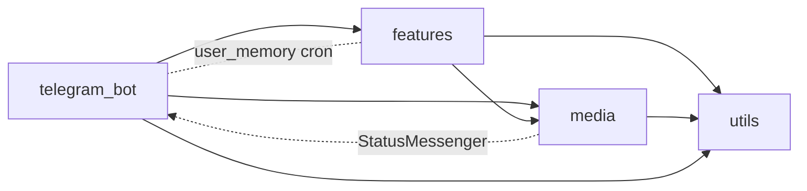

## Topology

The bot is a single Python 3.12 process (`main.py`) that runs `python-telegram-bot` in long-polling
mode. It is deployed as one Docker Compose service with FFmpeg installed. There are two pieces of state:

- A SQLite file at `/data/bot_messages.db` on the named volume `bot_data`, which survives rebuilds.
- Instagram cookies in `./secrets`, bind-mounted read-only at `/data/secrets`. They are refreshed on the
  host by `instagram-session`.

The bot calls these external services: Telegram Bot API, the platforms reached through yt-dlp and
gallery-dl, Google Gemini (raw `aiohttp` REST calls, always using the `googleSearch` tool), and the
GitHub REST API.

## Modules

| Module | Role |
|---|---|
| `config/` | `AppSettings` dataclass loaded from env, plus all user-facing strings (`MESSAGES`). |
| `core/` | Exceptions, logging setup, shared types. |
| `telegram-bot` | Builds the Application, gates updates, routes them to handlers, and logs messages. |
| `media` | Turns a URL into media posted in the chat. |
| `features` | Gork AI features and `bad bot` reprocessing. |
| `utils` | URL extraction, the chat allowlist, temp files, `run_blocking`, and the SQLite store. |

`config` and `core` are leaves that every module may import.

## Invariants

- **Configuration is centralized.** Settings come from `AppSettings` and user-facing text comes from
  `MESSAGES`. Business logic contains no literal user-facing strings and no tunable numbers. Known
  exceptions are listed under Known limitations.
- **The allowlist runs first.** A group −1 guard drops every update from a chat that is neither
  allowlisted nor a DM with an admin, before any other handler runs.
- **Blocking work stays off the event loop.** yt-dlp, gallery-dl, FFmpeg, OpenCV, and SQLite all run in
  threads (`run_blocking` / `asyncio.to_thread`).
- **Imports are absolute** (`from app.…`).

## Decisions

- **Media owns the whole download → send path.** `media` replies to the Telegram `Message` and drives
  the user-visible status through `StatusMessenger` from `telegram_bot`. This deliberately overrides
  the older guidance that downloaders should not know the Telegram API. The resulting
  `media → telegram_bot` import is accepted.
- **Gemini is called over raw REST, and the endpoint is mid-migration.** The target is
  `/v1beta/interactions` with `gemini-2.5-flash`, which mention, truth-check, and user-memory already
  use. `good bot` and GitHub-issue still use the older `models/gemini-2.5-flash-lite:generateContent`
  endpoint and will move to the target.

## Known limitations

- People and handles are hardcoded in code and compose defaults: the `McClintock96` "alpha",
  `@guys_being_dudes_bot`, the default allowlisted chat IDs, and the admin username and ID.
- Each feature builds its own Gemini request, parsing, and error handling. There is no shared client.
